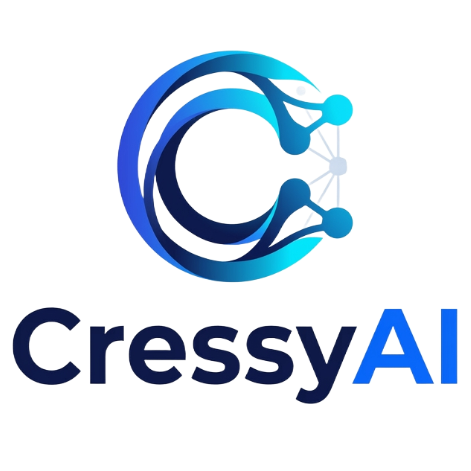

**New UI:** three-pane layout (chats · conversation · Files/Model/Settings tabs), light/dark/auto theme, steady word-by-word streaming with a blinking cursor, a collapsible *Thinking* card for reasoning models, rotating loading texts (Cooking…, Brewing…, Simmering…), and a file browser with **Back / Forward / breadcrumbs** (Backspace or Alt+← goes back).

A private chat UI for a local **GGUF** model. Nothing leaves your machine.

## Run it
```bash
python -m venv .venv && source .venv/bin/activate      # Windows: .venv\Scripts\activate
pip install -r requirements.txt
python server.py --model /path/to/model.gguf --root ~/my-project --open
```
Or use `./run.sh model.gguf [project-folder]` (macOS/Linux) / `run.bat model.gguf [project-folder]` (Windows).
Then open http://127.0.0.1:8000 (`--open` does it for you).

| Flag | Default | Meaning |
|---|---|---|
| `--model` | none | path to the coder `.gguf`; leave it out to start empty and load from the *Model* tab |
| `--models-dir` | `E:\AI\Models` | folder(s) scanned for `.gguf` files (repeatable); the coder's own folder is always scanned too |
| `--no-autoload` | off | start with nothing in memory even if `--model` is given |
| `--reasoner` | auto | reasoning `.gguf`; auto-picks `gemma-4-12b-it-Q4_K_M.gguf`, else `Qwen3-8B-Q6_K.gguf`, from the models folder |
| `--reasoner-n-ctx` | 8192 | context while the reasoner is loaded |
| `--no-reasoner` | off | don't look for a reasoner on start (you can still choose one in the app) |
| `--root` | `.` | the only folder the app can read (use your project) |
| `--n-ctx` | 4096 | context window; raise to 8192+ for big files |
| `--n-gpu-layers` | 0 | `-1` offloads everything to the GPU |
| `--threads` | auto | CPU threads |
| `--chat-format` | from GGUF | override if the model has no chat template |
| `--host` / `--port` | 127.0.0.1 / 8000 | keep loopback unless you know why |
| `--open` | off | open the browser on start |
| `--no-terminal` | off | disable the Terminal tab and the *Run* buttons |
| `--read-only` | off | never write into `--root` (downloads still work) |
| `--vision-model` | auto | Qwen2.5-VL `.gguf`; auto-found in `E:\AI\Models` or next to `--model` |
| `--vision-mmproj` | auto | its `mmproj` `.gguf`; auto-found next to the vision model |
| `--vision-n-ctx` | 8192 | context while the vision model is loaded |
| `--vision-max-tokens` | 1024 | max tokens of extracted details per image |
| `--no-vision` | off | disable image attachments |
| `--image-model` | auto | Stable Diffusion `.gguf`; auto-picks `stable-diffusion-xl-base-1.0-Q5_K_M.gguf` from the models folder |
| `--image-vae` | none | optional separate VAE (use `sdxl-vae-fp16-fix.safetensors` if images come out black) |
| `--image-clip-l` / `--image-clip-g` | auto | text encoder files, only needed when the `.gguf` holds just the UNet (auto-found as `clip_l*` / `clip_g*` in the models folder) |
| `--image-dir` | `./generated` | where generated images are saved |
| `--image-low-vram` | off | keep the text encoder and VAE on the CPU (slower, needs less VRAM) |
| `--image-flash-attn` | off | flash attention for the diffusion model (CUDA builds) |
| `--image-no-vae-tiling` | off | decode the whole image at once (faster, needs more VRAM) |
| `--image-threads` | auto | CPU threads for image generation |
| `--no-image` | off | disable image generation and editing |
| `--unsafe-remote-exec` | off | allow terminal and file writes on a non-loopback `--host` (**dangerous**) |

## Reasoning model (think first, then code)
Press **Reason** next to the paperclip (or start a message with `/think`). Only one model is ever in memory:

1. **Coder unloaded** and the **reasoner loaded** (`gemma-4-12b-it-Q4_K_M.gguf` if found, otherwise `Qwen3-8B-Q6_K.gguf`, both looked up in `E:\AI\Models`).
2. The reasoner works the task through; you watch it live in the collapsible *Thinking* card.
3. **Reasoner unloaded**, **coder reloaded**, and the coder writes the answer using those notes (they're added to that one request only, never shown as your message).

If the message has an image, the order is vision → reasoner → coder, and the coder is only loaded once, at the end. **Stop** at any point puts the coder back. If the reasoner can't load, the coder just answers normally and a note tells you why.
*Settings → Reasoning* has *Every message* vs *Only complex ones* (long messages, code, plan mode, or words like why/fix/design/refactor), the reasoner's temperature / top-p / top-k / repeat penalty, its **token budget**, and an optional replacement for the built-in reasoning instructions. The reasoner's own `<think>` tags are handled; models without them (Gemma) are simply told to reason first.

## Manual model control (Model tab → Models)
Each of **Coder**, **Reasoner** and **Vision** has a card:
- **Load / Switch** (pick any `.gguf` from the scanned folders, only files from those folders are accepted), **Unload**, **Reload**. Loading one unloads whatever else is in memory.
- **Tweak settings**: context size, GPU layers, CPU threads, batch size, flash attention, chat format. *Save* stores them for the next load; *Save & reload* applies them now. A card warns when the loaded model is running older settings.
- Buttons refuse politely while a reply is generating. Chatting with the coder unloaded loads it automatically.
- Starting the server with no `--model` is fine: nothing is loaded until you press **Load**.

## Images (Qwen2.5-VL, loaded only when needed)
Attach, drop or paste a PNG / JPG / WebP / GIF (up to 4 per message). Only one model is in memory at a time:

1. **Coder unloaded** the moment you send a message that has an image.
2. **Qwen2.5-VL** (`...-Q4_K_M.gguf` + `...-mmproj-f16.gguf`) is loaded and reads the image: it transcribes text/code/errors and describes layout and details, guided by what you typed.
3. **Both vision files are unloaded** as soon as the extraction is done.
4. **Coder reloaded**, and it answers your message using the extracted details, so follow-ups like "write the fix" or "turn this into a table" just work.

The status line and the model pill show which step is running; **Stop** cancels and puts your message back in the box. The extracted text appears under your message (*Image details*) and stays in the chat, so later turns do not re-read the image. Needs a `llama-cpp-python` recent enough to include `Qwen25VLChatHandler` (`pip install -U llama-cpp-python`, same CUDA/Metal build as before). Large images are shrunk to 1280 px in the browser first.

## Image generation and editing (Stable Diffusion XL)
One-time setup (optional, so the app still installs without a compiler):
```bash
pip install -r requirements-image.txt        # GPU builds: see the flags at the top of that file
```
Put `stable-diffusion-xl-base-1.0-Q5_K_M.gguf` in `E:\AI\Models` (or pass `--image-model`). The *Model* tab then shows an **Image** card.

- `/imagine a lighthouse at dawn, oil painting` (also `/img`, `/draw`) makes an image.
- `/imgedit make it night` (also `/retouch`) edits the **attached** image, or the last generated one. Editing is img2img: describe how the picture should look afterwards, and use *Settings → Images → Edit strength* (low keeps the original, high repaints it).
- The **Image** button (Alt+I) turns every message into an image prompt; attach a picture and it edits that instead.
- Under each image: **Enlarge**, **Download**, **Edit**, **Vary** (small img2img change), **Re-roll** (new seed), **Save** (copies it into `generated-images/` in your project folder).
- By default the coder first rewrites your words into a proper Stable Diffusion prompt (you can read it under each image; switch it off in Settings → Images).

How it uses memory: only one model is ever loaded. The coder writes the prompt, is **unloaded**, the image engine runs in a **separate process** (so all RAM/VRAM is released when it exits), then the coder is **reloaded**. **Stop** (Esc) kills the image process and brings the coder back. Images are saved in `generated/` with the settings embedded in the PNG.

Not included: inpainting with a mask, and instruction-style editing ("make the sky red" without describing the whole picture) — SDXL base does prompt-guided img2img only.

## Workspace: files, terminal, plans, charts
The model is taught (via a short system prompt, switch it off under *Settings → Workspace*) to answer in formats the app turns into actions. Small models need `Precise` sampling and one task per message.

| Feature | How it works |
|---|---|
| **Create files** | A ` ```file:src/app.py ` block gets *Save…* and *Download* buttons. *Save…* shows a review dialog (new file, or a diff if it overwrites), then writes inside `--root`. |
| **Edit files** | An ` ```edit:path ` block holds `<<<<<<< SEARCH` / `=======` / `>>>>>>> REPLACE` sections. *Review edit* applies them to the current file (project, earlier edits this chat, or an attachment), shows the diff, then *Save to project* or *Download*. Ambiguous or missing matches are reported instead of guessed; CRLF line endings are preserved. Attach the file first (`@path`) so the model can see it. |
| **Changes tab** | Everything you saved or downloaded this session, with *Diff*, *Download*, *Save*, **Download all (.zip)** and *Save all*. |
| **Terminal** | Right-panel tab (Alt+T) streams a command's output live, with Stop, history (↑/↓) and a time limit (Settings). `bash` blocks in a reply get a **Run** button that asks first, shows the output under the block, and **Send output to chat** lets the model read the result. Each command starts fresh in `--root` (no state carried between commands). |
| **Plan mode** | Toggle *Plan* next to the paperclip, or use `/plan <goal>`. The model writes Goal / Approach / Files / Steps / Risks and nothing else. The plan card lets you tick steps, **Build** one step, **Build everything**, or **Revise**. Approving turns plan mode off. Progress is saved with the chat. |
| **Charts & diagrams** | A ` ```chart ` block (JSON: `type`, `title`, `labels`, `datasets`) becomes a chart: bar, line, area, pie, doughnut, radar, polarArea, scatter; *Save PNG* included. A ` ```mermaid ` block becomes a diagram (*Save SVG*). Try `/chart`, `/diagram`. Invalid specs show a clear error instead of breaking the message. |
| **Other commands** | `/newfile`, `/edit`, `/run` ask for the matching format. |

Charts, the zip download and diagrams load Chart.js, JSZip and Mermaid from cdnjs the first time they are used (like the existing markdown/highlight libraries), so that needs internet once.

## What you can do
**Slash commands** – paste code after the command, attach a file, or run it bare to use the last code block in the chat.

| Command | Does |
|---|---|
| `/explain` `/fix` `/review` `/refactor` | understand, debug, review, clean up code |
| `/test` `/doc` `/bigo` | unit tests, docstrings, complexity analysis |
| `/commit` | Conventional Commit message from your **staged** diff |
| `/review` (bare) | reviews your **working** diff |
| `/regex` `/sql` `/shell` `/name` `/eli5` | describe what you need in words |
| `/convert` | `/convert Go` + newline + code |
| `/help` | list commands and shortcuts |

**@file mentions** – type `@src/app.py` to attach it (Tab autocompletes from the project).
**Git buttons** (Files panel) – attach working diff, staged diff or last commit.
**Search in files** – substring search across the project, click *Add* to attach a hit.
**Modes** – Code helper, Code reviewer, Debugger, Tutor (set the system prompt) and sampling presets Precise / Balanced / Creative.
**Chats** – auto-saved in your browser (last 50), reopen from the *Chats* list, export as Markdown.
**Message actions** – Copy, Retry (last reply), Edit (rewinds the chat to that message), Delete.
**Code blocks** – *Copy* and *Save* (downloads with the right extension).
**Context guard** – when a chat outgrows the context window the oldest turns are dropped automatically; the reply footer shows how many.
**Settings** are remembered between sessions. Also: drag-and-drop files, live tokens/sec, context bar, RAM/CPU, GGUF metadata.

## Shortcuts
Enter send · Shift+Enter newline · Esc stop/close popup · ↑/↓ recall earlier messages · Tab accept suggestion ·
Alt+N new chat · Alt+L focus input · Alt+R retry · Alt+C copy last reply · Alt+E export · Alt+S side panel · Alt+T terminal · Alt+/ help ·
Alt+I image mode · Alt+G new seed for the last image · Alt+V edit the last image

## Tips
- Small models forget fast: use *Precise*, give one task per message, attach only the files that matter.
- Slow? Use a smaller or more quantized model (Q4_K_M), or `--n-gpu-layers -1`.
- Out of context? Raise `--n-ctx` (uses more RAM).

## Safety notes
- **Terminal and file writing run with your user permissions.** They only work when the server is bound to loopback (the default), require a custom header and a same-site `Origin` (so other websites cannot call them), and *Run* on a model-suggested command asks first. You are still running commands a language model wrote: read them. Use `--no-terminal` / `--read-only` to turn either off.
- Writes are confined to `--root`, refuse `.git/`, binary files and symlinks that leave the folder, and are atomic. Keep the project under git so you can undo.
- The server only reads inside `--root` and rejects non-loopback `Host` headers. Don't set `--root` to `~` or `/`, and don't expose it with `--host 0.0.0.0` on an untrusted network.
- Files like `.env` are readable if they're inside `--root`; keep secrets out of the folder or don't attach them.
- Attachments are not restored when you reopen a saved chat (their names are kept, content is not).

## Troubleshooting
- `llama-cpp-python` fails to build: install a C/C++ toolchain (Xcode CLT / build-essential / VS Build Tools) or use a prebuilt wheel.
- Images: "stable-diffusion-cpp-python is not installed" → `pip install -r requirements-image.txt` inside the app's `.venv`.
- Images: "get sd version from file failed" / "NULL pointer": stable-diffusion.cpp could not recognise the `.gguf`. The error card lists what the file contains; a UNet-only file needs a full SDXL `.gguf` or `clip_l` / `clip_g` / VAE files in the models folder.
- Images come out completely black: the SDXL VAE overflows in half precision. Download `sdxl-vae-fp16-fix.safetensors` and pass `--image-vae path\to\it`.
- Image engine runs out of memory: pick a smaller size in Settings → Images, or start with `--image-low-vram`.
- Garbled replies: pass `--chat-format` (e.g. `chatml`, `llama-3`).
- "Binary or unreadable file": only text files can be attached.
- Port busy: `--port 8001`.

**New in this version**
- **Preview / Run** buttons on `html`, `svg` and `js` code blocks open a sandboxed live preview (Claude-style artifacts, fully offline).
- **Memory** (Settings tab) plus `/remember <fact>`: standing notes sent with every chat.
- **`/compact`** summarizes the chat to free context; a hint appears when the window is 85% full. **Continue** button when a reply hits the token limit.
- **13 new task commands**: `/summarize` `/tldr` `/rewrite` `/proofread` `/translate` `/email` `/outline` `/plan` `/brainstorm` `/proscons` `/table` `/quiz` `/steps`, and new modes: Writer, Analyst, Study buddy, Brainstorm, Translator.
- **Chats**: search (titles and message text), pin to top, back up / restore all chats as JSON.
- **Speed flags**: `--n-batch 512` and `--flash-attn` for faster prompt processing.
